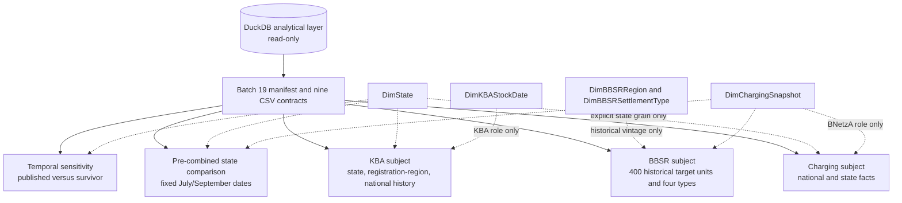

# Architecture

## Current architecture

The project is a local, file-based analytical workflow. The current DuckDB database is a built artifact under data/analytics and is inspected read-only during analysis. Original workbooks remain under data/raw and are not changed by the ingestion scripts.

~~~mermaid
flowchart LR
    A[Official XLSX sources] --> B[config/sources.json]
    B --> C[scripts/01_download.py]
    C --> D[data/profiles/download_inventory.json]
    C --> E[data/raw]
    E --> F[scripts/02_profile_xlsx.py]
    F --> G[data/profiles/workbook_profiles.json]
    E --> H[scripts/03_inspect_schema.py]
    H --> I[data/profiles/schema_inspection.json]
    E --> J[scripts/03_build_duckdb.py]
    G --> J
    J --> K[(DuckDB raw schema)]
    K --> L[(DuckDB core schema)]
    L --> M[(DuckDB analytics views)]
    L --> N[scripts/04_build_geographic_crosswalk.py]
    N --> O[data/reference/bnetza_kba_district_crosswalk_2026.csv]
    L --> P[scripts/batch_analysis.py]
    O --> P
    M -. planned extract .-> Q[Tableau Public]
    O --> R[Deployed geographic analytics layer]
    L --> R
    E --> S[scripts/10_build_bbsr_reference.py]
    S --> T[data/reference/bbsr_settlement_types_2025.csv]
    S --> U[data/reference/bbsr_source_manifest.json]
~~~

The Tableau path remains planned. Batch 06 deployed the approved geographic reference table and analytics views to the local DuckDB file; the crosswalk mappings remain partly provisional and are not an official boundary gazetteer.

Batch 23 adds a separate static web presentation path. It starts from the
validated Batch 19/21 CSV contracts, validates and normalizes them with
`web/scripts/prepare-data.mjs`, writes `web/public/data/dashboard.json`, and
serves two React/ECharts pages through Vite. The browser never connects to
DuckDB or an external API. The page-two map uses a locally verified 16-state
GeoJSON asset with attribution and checksum metadata. See
[`web-dashboard-architecture.md`](web-dashboard-architecture.md) and
[`web-dashboard-design.md`](web-dashboard-design.md).

## Source and ingestion stages

1. config/sources.json records the four primary BNetzA/KBA source IDs plus the separately handled BBSR reference source, including reference dates, paths, direct URLs, source pages, and declared reuse licenses.
2. scripts/01_download.py downloads or verifies the original XLSX files and writes byte counts and SHA-256 hashes to data/profiles/download_inventory.json.
3. scripts/02_profile_xlsx.py streams the XML inside each workbook and counts every physical and populated row across every worksheet without rewriting the source.
4. scripts/03_inspect_schema.py previews early worksheet rows to identify title, header, and data positions.
5. scripts/03_build_duckdb.py inserts all populated raw worksheet rows, then creates the initial core tables and analytics views.
6. scripts/04_build_geographic_crosswalk.py opens DuckDB read-only and writes a versioned CSV crosswalk plus a validation report.
7. scripts/batch_analysis.py runs named SELECT or WITH queries on one read-only DuckDB connection and writes one structured Markdown report.
8. scripts/06_deploy_geographic_layer.py performs the approved backup, prerequisite checks, transactional deployment, and state-view correction; scripts/06_validate_geographic_layer.py independently validates the deployed objects read-only.
9. scripts/10_build_bbsr_reference.py reads the preserved BBSR workbook, inspects every worksheet, extracts the approved four-category Kreisreferenz grain, and writes a deterministic CSV plus source/derived checksums. The reference path stops outside DuckDB and the BNetzA-to-KBA Crosswalk.
10. scripts/12_audit_bbsr_integration_paths.py audits the BNetzA-source and KBA-registration paths read-only; its Path A output is the evidence input for the approved charging-only deployment.
11. scripts/13_deploy_bbsr_charging_layer.py independently rechecks Path A identities, creates/validates the versioned BNetzA-to-BBSR bridge, validates a safe backup, and deploys only the new BBSR reference and charging views transactionally.
12. scripts/13_1_deploy_bbsr_scenario.py validates the two-row owner-override reference, checks the existing Crosswalk identifiers, creates a verified backup, and deploys only the separate 2026 scenario table and views transactionally.

## DuckDB schemas

### raw

The raw schema preserves the source row structure:

- raw.bnetza_rows contains source_id, excel_row, and col_a through col_au for every populated BNetzA worksheet row, including metadata rows.
- raw.kba_rows contains source_id, reference_date, sheet_name, excel_row, and col_a through col_o for every populated row across all 20 worksheets in each KBA workbook.

Raw KBA rows retain title, header, footnote, subtotal, and alternate-breakdown content. They are not a vehicle fact table.

### core

The current core schema contains:

- core.charging_equipment: one row per BNetzA equipment record after the source header region.
- core.charging_point: one row per populated charging-point slot represented by the six repeated point groups in the BNetzA sheet.
- core.kba_state_fuel_stock: selected state-level FZ 27.2 fuel-category values across the three reference dates.
- core.kba_district_ev_stock: one row per KBA district code and reference date from FZ 27.15.
- core.kba_postcode_ev_stock: postcode-level BEV/PHEV values from FZ 27.16.
- core.kba_municipality_ev_stock: municipality-level commercial/private BEV/PHEV values from FZ 27.17.

### reference

- reference.bnetza_kba_district_crosswalk_2026: one row per BNetzA source state/district combination for crosswalk version 2026-07-01, with source lineage, KBA identifiers, mapping method/status, verification fields, notes, evidence URL, and source aggregates. Its 401 rows map to 400 KBA codes because both Trier source rows use code 07211.
- reference.bnetza_bbsr_district_bridge_2025: one row per BNetzA source state/district combination. It preserves BBSR KRS/Kreisregion fields as strings, source dates, Path A evidence, and compatibility status. Its only uniqueness rule is the composite BNetzA source key; BBSR codes are not globally unique in this table.
- reference.bnetza_bbsr_owner_override_2026: exactly two owner-approved scenario rows for BNetzA source districts `06415` and `06435`. It exposes the scenario version, BNetzA source identity, Crosswalk-derived code identifier, boundary vintage, analytical category, classification method, official-verification boolean, caveat, population context, and evidence URLs. It is not an official BBSR reference and does not replace the Batch 13 bridge.

### analytics

The current views are:

- analytics.charging_point_public: public charging-point detail joined to its equipment attributes; the source Public Key is not exposed.
- analytics.charging_by_state: state-level equipment and populated-point counts using source-aware point aggregation and joins on (source_id, excel_row).
- analytics.charging_by_kba_district_2026_09_30: one row per KBA district code for the BNetzA 2026-09-30 snapshot, with separate equipment and point aggregates, maximum-per-point power bands, percentages, and mapping-quality flags.
- analytics.kba_district_charging_vs_bev_2026: one row per KBA district code and actual KBA stock reference date, retaining both source dates and provisional geographic indicators.
- analytics.kba_national_quarterly_stock: de-duplicated national historical rows from FZ 27.9.
- analytics.charging_by_bbsr_district_2025: one row per original BNetzA state/district combination, with dated BBSR enrichment and charging-only equipment/point metrics.
- analytics.charging_by_bbsr_type_2025: five rows for BBSR types 1–4 and `UNCLASSIFIED`; category point-share denominators include all 401 source districts.
- analytics.charging_by_bbsr_district_2026_scenario: one row per original BNetzA state/district, retaining the official baseline fields and overlaying the two owner-approved category assignments. It contains scenario vintage, provenance, method, verification, caveat, and source-audit fields.
- analytics.charging_by_bbsr_type_2026_scenario: four owner-scenario category rows. It reports charging-only KPIs, override counts, the zero `UNCLASSIFIED` count, and all national point-share denominator metadata.

The state view’s source-aware join issue was corrected in Batch 06. Its output column names, order, 16-state grain, and current metrics were preserved. Any future multi-snapshot load must retain the same source-aware key.

## Equipment-to-point relationship

The safe source-local relationship is:

- Equipment row identity: (source_id, excel_row).
- Point row relationship: (source_id, equipment_excel_row).
- Point slot identity for validation: (source_id, equipment_excel_row, point_number).

equipment_id is retained as the source identifier, but the build and validation logic uses source_id plus Excel row to avoid accidental collisions across source files. The current snapshot has 117,662 equipment rows and 211,253 point rows. Declared point count and populated point slots reconcile exactly in the current snapshot.

connector_types and connector_power_raw are point-level text fields. A semicolon-separated power string remains within one point row; it is not exploded into multiple points or connectors.

## Geographic crosswalk and deployed reporting layer

The current crosswalk is a curated CSV reference with 401 BNetzA state/district rows and 400 distinct KBA district codes. Batch 06 also loaded an auditable copy into reference.bnetza_kba_district_crosswalk_2026. The CSV remains the versioned input; the DuckDB table adds bnetza_source_id for lineage and preserves all mapping method, verification status, notes, evidence URL, and source aggregate fields.

The deployed geographic model is:

1. reference.bnetza_kba_district_crosswalk_2026, one row per BNetzA state/district combination and its KBA code.
2. analytics.charging_by_kba_district_2026_09_30, one row per KBA code and BNetzA reference date.
3. analytics.kba_district_charging_vs_bev_2026, one row per KBA code and actual KBA stock reference date.

Charging must be aggregated by KBA code before joining KBA stock. This is mandatory because Kreisfreie Stadt Trier and Landkreis Trier-Saarburg both map to KBA registration-region code 07211. A raw 401-row join would duplicate that KBA stock.

## BBSR feasibility background

Batch 09 assessed the official BBSR four-category settlement-structural district
typology as a possible future reference dimension. At that batch boundary, the
current BBSR artifact was
`raumgliederungen-referenzen-2025.xlsx` at geographic stand 31.12.2025. Its
`Kreisreferenz` sheet contains 400 administrative Kreis rows and 362 Kreisregion
keys. It was not a KBA registration-region table and, at that batch boundary,
was not yet in the source manifest, DuckDB, Crosswalk, or Tableau path.

The recommended future architecture is a separate versioned BBSR KRS/Kreisregion
reference plus an explicit KBA compatibility relation. The compatibility relation
must retain source systems, effective dates, and statuses such as
`mixed_or_unresolved` and `vintage_mismatch`; it must never replace AGS, ARS, KRS,
or KBA keys with an unnamed generic region key. Direct BBSR-type assignment to all
KBA codes is not approved. In particular, the 2025 BBSR table does not contain a
separate Hanau row, and BBSR gives Trier city and Trier-Saarburg different types
while KBA combines their stock under 07211.

See [reports/batch09_bbsr_feasibility.md](../reports/batch09_bbsr_feasibility.md)
for the source register, strategy assessment, proposed minimal model, and
validation gates. At the Batch 10 boundary no BBSR schema or analytical object
existed in the database; Batch 13 now adds only the separately named
source-grain bridge and charging-only views described below.

## Batch 10 BBSR reference path — separate from DuckDB

Batch 10 acquired the latest suitable official BBSR reference listed on the
download page: raumgliederungen-referenzen-2025.xlsx, geographic stand
31.12.2025 and workbook stand 11.09.2026. The Kreisreferenz sheet contains
400 administrative Kreis rows, 362 Kreisregion keys, and the compact
four-category settlement-structural type. The workbook has six sheets and its
complete original column inventory is recorded in
data/reference/bbsr_source_manifest.json.

The versioned derived artifact is
data/reference/bbsr_settlement_types_2025.csv. Its grain is one row per BBSR
KRS2025 administrative Kreis row; repeated Kreisregion keys preserve the
original component relationship. The raw workbook remains ignored under
data/raw/bbsr/.

This is a reference dimension, not a KBA registration-region table. Batch 13
uses it through a separate, versioned BNetzA-source-grain bridge; it does not
change the existing Crosswalk, assign one BBSR type to KBA codes, join KBA
stock, or allocate the shared Trier stock. Future compatibility work must
retain source systems, effective dates, classification vintages, and visible
statuses such as mixed_or_unresolved and vintage_mismatch.

See reports/batch09_bbsr_feasibility.md for the strategy assessment and
reports/batch10_bbsr_reference_validation.md for the source/build evidence.

## Batch 13 BBSR charging-only layer

Batch 13 implements the approved Path A use at the original BNetzA
state/district grain. The reproducible bridge is
`data/reference/bnetza_bbsr_bridge_2025.csv`; the deployment definitions are
[`sql/13_bbsr_charging_layer.sql`](../sql/13_bbsr_charging_layer.sql) and
[`scripts/13_deploy_bbsr_charging_layer.py`](../scripts/13_deploy_bbsr_charging_layer.py).

The bridge has 401 rows: 399 `VERIFIED_COMPATIBLE`, one conditional-vintage
Main-Kinzig-Kreis row, and one unresolved Hanau row. Settlement types are
populated only for the 399 verified rows. Main-Kinzig's BBSR administrative
and Kreisregion code is retained as pre-change evidence but its type is NULL;
Hanau has no BBSR 2025 row and remains fully unclassified.

The two analytics views calculate equipment and point metrics separately. Point
power is parsed from semicolon-separated raw text, decimal commas are accepted,
and the maximum valid token is used once per point. The summary view reports
within-category shares separately from each category's share of all 211,253
registered points, with the latter denominator explicitly including
`UNCLASSIFIED`. No KBA table, BEV/PHEV field, or vehicle-stock denominator is
used. Full results and backup evidence are in
[`reports/batch13_bbsr_charging_deployment.md`](../reports/batch13_bbsr_charging_deployment.md).

## Batch 13.1 owner-approved 2026 analytical scenario

Batch 13.1 is deliberately separate from the **OFFICIAL BBSR 2025 BASELINE**.
The reproducible input is
`data/reference/bnetza_bbsr_owner_override_2026.csv`, with its hash and source
lineage in the matching manifest. The code identifiers `06415` and `06435` are
the existing Crosswalk `kba_district_code` values for the observed BNetzA
source rows; they are identifiers, not evidence that KBA and BBSR boundaries
are equivalent.

The scenario overlays Hanau with category 1 using
`OWNER_APPROVED_SCENARIO`, and Main-Kinzig-Kreis with category 2 using
`HISTORICAL_BBSR_CARRY_FORWARD`. Both rows have
`official_bbsr_verification = false`. Hanau has no official BBSR 2025 type and
must never be described as an official BBSR 2026 classification. Main-Kinzig's
type 2 is carried forward with the explicit caveat that Hanau separated in
2026. The official bridge, reference CSV, five-row summary, Crosswalk, raw/core
tables, KBA views, and state view remain unchanged.

The scenario district view reuses the official Batch 13 source-aware charging
view, so equipment and point grains remain separate and each point is
classified once from the maximum valid semicolon-separated
`connector_power_raw` token. It contains no KBA stock join. The scenario type
view has 4 rows, covers all 401 source districts, and reports zero
`UNCLASSIFIED` districts. See
[`reports/batch13_1_bbsr_scenario_classification.md`](../reports/batch13_1_bbsr_scenario_classification.md)
for the KPI table, backup fingerprints, evidence URLs, and validation record.

## Deployment SQL and design history

The authoritative executable definitions are in [sql/06_geographic_layer.sql](../sql/06_geographic_layer.sql), executed by [scripts/06_deploy_geographic_layer.py](../scripts/06_deploy_geographic_layer.py). The detailed design and acceptance checks remain in [geographic-layer-design.md](geographic-layer-design.md). The abbreviated definitions below are retained as architecture history and are not the deployment source.

The following abbreviated definitions show the intended grain and join order. They are historical shorthand; the deployed object names and full power/parser logic are in the SQL file.

~~~sql
-- Planned reference relation; current source is the curated CSV.
CREATE TABLE reference.bnetza_kba_district_crosswalk_2026 (
    crosswalk_version VARCHAR,
    bnetza_reference_date DATE,
    kba_reference_date DATE,
    bnetza_state_name VARCHAR,
    bnetza_district_name VARCHAR,
    bnetza_admin_type VARCHAR,
    kba_district_code VARCHAR,
    kba_district_name VARCHAR,
    mapping_status VARCHAR,
    mapping_method VARCHAR,
    verification_status VARCHAR,
    mapping_note VARCHAR,
    evidence_url VARCHAR
);

-- Planned charging aggregation: one row per KBA code and BNetzA snapshot.
CREATE VIEW analytics.charging_by_kba_district_2026_09_30 AS
SELECT
    c.kba_district_code,
    SUM(equipment_rows) AS equipment_rows,
    SUM(declared_point_count) AS declared_point_count,
    SUM(charging_point_slots) AS charging_point_slots,
    SUM(equipment_nominal_power_kw) AS equipment_nominal_power_kw,
    DATE '2026-09-30' AS bnetza_reference_date
FROM reference.bnetza_kba_district_crosswalk_2026 c
WHERE c.mapping_status = 'mapped'
GROUP BY c.kba_district_code;

-- Planned vehicle join: preserve one KBA row per code and date.
CREATE VIEW analytics.kba_district_charging_vs_bev_2026 AS
SELECT
    c.kba_district_code,
    c.bnetza_reference_date,
    k.reference_date AS kba_reference_date,
    c.equipment_rows,
    c.charging_point_slots,
    k.passenger_cars,
    k.bev_cars,
    k.phev_cars
FROM analytics.charging_by_kba_district_2026_09_30 c
LEFT JOIN core.kba_district_ev_stock k
  ON k.district_code = c.kba_district_code
 AND k.reference_date = DATE '2026-07-01';
~~~

The final implementation must add source-date keys, preserve unmapped/provisional rows as quality flags, and validate code uniqueness before any DDL is approved.

## Database limitations

- DuckDB tables contain the current source snapshots, not a slowly changing historical infrastructure model.
- The BNetzA snapshot is a published register and is not exhaustive.
- KBA district rows, postcode rows, municipality rows, and state-level rows are alternative reporting grains. They must not be summed together as though they were additive partitions.
- The latest infrastructure and vehicle dates are not contemporaneous.
- No utilization or energy-delivery tables exist.
- The deployed state view is source-aware; future multi-snapshot loading must retain the (source_id, excel_row) equipment key and rerun the validation suite.

## Batch 20 — Tableau semantic model design (2026-11-03)

Batch 20 defines a design-only semantic layer over the nine validated Batch 19
CSV exports. The recommended initial architecture is a set of separate
Tableau data sources: charging infrastructure, charging-only historical BBSR,
KBA stock, a fixed state EV/charging comparison, and temporal sensitivity. No
physical Fact/Dimension tables or Tableau assets are created.

The full fact/dimension catalog is in
[`docs/tableau-fact-dimension-catalog.md`](tableau-fact-dimension-catalog.md),
and relationship contracts are in
[`docs/tableau-relationship-design.md`](tableau-relationship-design.md).
The model does not treat nine exports as nine tables that must be joined: each
file remains an analytical subject at its validated grain. National charging
is not a seventeenth state; BBSR 400 historical units are not KBA 400
registration regions; and the state comparison/temporal files remain
pre-combined facts.

The Batch 20 validation report records the actual object columns/types,
natural-key checks, 1,734 export rows, baseline reconciliations, 401-to-400
BBSR harmonization, 16-state/date matches, and unchanged source/database
fingerprints. The architecture decision recommends the separate-source model
over a multi-fact relationship model until stable shared keys and date-role
contracts are implemented in a separately approved batch.

## Batch 21 — executive overview preparation

Batch 21 adds only a presentation layer over the Batch 19 contracts. The
preparation script reads the manifest-listed exports and opens DuckDB
read-only for the equipment-status counts. It writes two small CSVs under
`data/exports/tableau/preparation/`: one four-row mutually exclusive power-band
file and one two-row equipment-status file. It does not add a DuckDB relation,
alter an export, or create a Fact-to-Fact join.

The two dashboards use six separate Tableau subject sources: national
charging, power bands, national KBA history, equipment status, state charging,
and the fixed state comparison. The geographic map is allowed only through
Tableau's official Bundesland geographic recognition; fabricated boundaries or
image-derived state values are prohibited. The full worksheet/source contract
is in [`docs/tableau-executive-overview.md`](tableau-executive-overview.md),
and validation is in
[`reports/batch21_tableau_overview_validation.md`](../reports/batch21_tableau_overview_validation.md).

Batch 22.1 identified the official Tableau Desktop Authoring MCP as a
conditional native authoring bridge. It drives a running Desktop instance
through the External Client API rather than Accessibility or Screen Recording,
but the source build, Codex MCP entry, live 2026.3 API handshake and workbook
smoke test remain approval-gated. No `.twb`, `.twbx`, extract or screenshot is
part of the current architecture. See
[`reports/batch22_1_tableau_desktop_mcp_feasibility.md`](../reports/batch22_1_tableau_desktop_mcp_feasibility.md).

## Batch 22.2 — official Desktop MCP setup result

The isolated official Tableau MCP `v5.3.0` source build and local Codex stdio
registration are now present outside the analytical project. The Desktop
bundle initializes and exposes the expected authoring/readback tool surface;
headless template discovery also passes. The live integration remains
`MCP_SETUP_PARTIAL` because Tableau Desktop 2026.3.0 is running with
`Settings.ExternalApiEnabled=0`, so it publishes no External Client API
discovery file. Native workbook authoring must remain deferred until the owner
approves that existing preference change and the read-only session handshake
passes. No project data, export, workbook or database object is part of this
bridge state.

## Batch 22.3 — External Client API validation result

Batch 22.3 verified the exact macOS user preference domain and backed up only
the Tableau 2026.3 plist outside Git. The owner-approved integer write to
`Settings.ExternalApiEnabled` read back as `1` before launch, but Tableau
Desktop reverted it to `0` during startup. The local startup evidence records
`FreeEditionActive`; the batch treats this as an observed limitation signal,
not an undocumented license claim. No External Client API discovery file or
listener appeared, so the official Desktop MCP could not inspect a live
workbook. The architecture remains data-ready but native Tableau authoring is
blocked until a supported Desktop configuration passes `list-instances` and
the read-only live workbook handshake. See
[`reports/batch22_3_tableau_external_api_validation.md`](../reports/batch22_3_tableau_external_api_validation.md).

## Batch 22.4 — External Client API diagnosis result

The local startup-reset diagnosis is complete. Tableau Desktop 2026.3.0
accepts the pre-launch integer preference write, then initializes the runtime
as `FreeEditionActive`, restores `Settings.ExternalApiEnabled=0`, and
publishes no External Client API discovery file. User/system/managed preference
precedence, MDM state, MCP configuration and missing API libraries were not
the cause in the inspected installation. The precise internal edition rule is
not published and remains qualified as an inference from the correlated
startup evidence.

The official MCP source and Tableau licensing documentation do not establish a
supported Free Edition method for keeping the External Client API enabled. The
MCP build therefore remains a paused optional bridge, not an authoring
dependency. The next supported branch is an owner-approved paid Desktop
configuration/support decision followed by a read-only handshake, or an
isolated GUI fallback with explicit macOS permissions and local native
save/reopen verification. No Tableau workbook, data source, export, DuckDB
object or KPI contract was added.

See [`reports/batch22_4_tableau_external_api_diagnosis.md`](../reports/batch22_4_tableau_external_api_diagnosis.md).

## Batch 22.5 — local GUI automation capability check

The local GUI fallback was tested read-only through the VS Code OpenAI Codex
extension's native `codex` app-server. System Events and macOS Accessibility
could read Tableau Desktop 2026.3.0's process, focused window, menus and
start-pane controls, and the built-in screen-capture primitive produced a
valid 2560 × 1600 PNG. The TCC database itself was protected; no permission
was changed or bypassed.

The blank `Tableau - Book1` window did not expose a named worksheet-tab strip
or field pane in the 339-node AX tree, and the screenshot did not show a
rendered worksheet canvas. The result is `LOCAL_AUTOMATION_PARTIAL`: host and
permission prerequisites are operational, but field interaction, worksheet
selection, dashboard layout, native save/reopen and workbook readback remain
untested. No Tableau workbook or project data was added, and the external API
MCP remains paused.

See [`reports/batch22_5_local_automation_capability_check.md`](../reports/batch22_5_local_automation_capability_check.md).
