# Tableau Relationship Design — Batch 20

This document defines safe logical relationships for the recommended
domain-specific model. It does not create Tableau relationships or physical
Fact/Dimension tables.

## 1. Relationship principles

1. Start each subject as a standalone Tableau data source backed by one
   validated Batch 19 export.
2. Prefer Tableau **logical relationships** over physical joins. A relationship
   must preserve the grain of every participating fact.
3. Use shared dimensions only when the business key, date role, and scope are
   explicit. A similar label or equal row count is not evidence of a valid
   geographic relationship.
4. Keep `DimChargingSnapshot` and `DimKBAStockDate` as separate date roles.
5. Do not physically join facts to facts. The state comparison and temporal
   sensitivity exports already contain their approved cross-source combination.
6. If a future physical dimension is not present, use Tableau's safe defaults:
   do not assert `All Records Match`, and do not assert a one-to-one fact
   relationship. Validate the key before setting a one-to-many cardinality.

## 2. Recommended relationship diagram

```mermaid
erDiagram
    DIM_STATE ||--o{ FACT_STATE_CHARGING : "state_key / state_name"
    DIM_CHARGING_SNAPSHOT ||--o{ FACT_STATE_CHARGING : "charging_snapshot_key"

    DIM_BBSR_REGION ||--o{ FACT_BBSR_CHARGING : "bbsr_region_key"
    DIM_BBSR_SETTLEMENT_TYPE ||--o{ FACT_BBSR_CHARGING : "type_key"
    DIM_CHARGING_SNAPSHOT ||--o{ FACT_BBSR_CHARGING : "charging_snapshot_key"
    DIM_BBSR_SETTLEMENT_TYPE ||--o{ FACT_BBSR_TYPE_CHARGING : "type_key"
    DIM_CHARGING_SNAPSHOT ||--o{ FACT_BBSR_TYPE_CHARGING : "charging_snapshot_key"

    DIM_STATE ||--o{ FACT_KBA_STATE_STOCK : "state_key / state_name"
    DIM_KBA_STOCK_DATE ||--o{ FACT_KBA_STATE_STOCK : "kba_stock_date_key"
    DIM_KBA_REGISTRATION_REGION ||--o{ FACT_KBA_REGION_STOCK : "region_key"
    DIM_KBA_STOCK_DATE ||--o{ FACT_KBA_REGION_STOCK : "kba_stock_date_key"
    DIM_KBA_STOCK_DATE ||--o{ FACT_KBA_NATIONAL_HISTORY : "stock_date_role"

    DIM_STATE ||--o{ FACT_STATE_COMPARISON : "state_key"
    DIM_KBA_STOCK_DATE ||--o{ FACT_STATE_COMPARISON : "kba_date_role"
    DIM_CHARGING_SNAPSHOT ||--o{ FACT_STATE_COMPARISON : "bnetza_date_role"

    DIM_STATE ||--o{ FACT_TEMPORAL_SENSITIVITY : "state_key"
    DIM_KBA_STOCK_DATE ||--o{ FACT_TEMPORAL_SENSITIVITY : "kba_date_role"
    DIM_CHARGING_SNAPSHOT ||--o{ FACT_TEMPORAL_SENSITIVITY : "bnetza_date_role"
```

There are deliberately no edges between fact nodes. In particular,
`FACT_STATE_CHARGING` is not directly joined to `FACT_KBA_STATE_STOCK`,
`FACT_BBSR_CHARGING` is not joined to `FACT_KBA_REGION_STOCK`, and
`FACT_STATE_COMPARISON` is not joined to either component fact.

## 3. Relationship contract matrix

The cardinality below is the intended semantic cardinality after future
surrogate dimensions are materialized. Current CSVs prove the natural-key
uniqueness shown in the evidence column, but they do not contain physical
foreign-key columns.

| Source dimension | Target fact | Relationship key | Intended cardinality | RI assumption / expected unmatched | Valid filter path | Invalid path or behavior | Duplication risk / Tableau behavior |
|---|---|---|---|---|---|---|---|
| `DimState` | `FactStateCharging` | `state_key`; current natural key `state_name` | 1:N | One row per state per charging snapshot; current 16 state keys match | Filter state charging measures within the BNetzA snapshot | Do not use a state filter to make a national row a state row | Zero unmatched in current 16-row export. Use logical relationship; preserve measure grain. |
| `DimChargingSnapshot` | `FactStateCharging` | `charging_snapshot_key`; current `bnetza_reference_date` | 1:N | Current charging date is required and unique | Select the BNetzA snapshot | Do not map a KBA stock date to this role | Zero unmatched at current date. Never repeat the fact over KBA dates. |
| `DimBBSRRegion` | `FactBBSRCharging` | `bbsr_region_key`; current historical target code plus vintage | 1:N | 400 unique target codes; 400 matching fact rows | Filter historical BBSR unit/type analysis | Do not filter KBA registration-region facts with BBSR codes | Zero unmatched in harmonized export; source provenance remains on fact. |
| `DimBBSRSettlementType` | `FactBBSRCharging` | `(bbsr_reference_date, bbsr_settlement_type_code)` | 1:N | Four type keys match all 400 target rows | Group/filter within historical BBSR charging | Do not treat type as a current KBA state or region attribute | Zero unmatched in harmonized target export. Aggregate target rows before type shares. |
| `DimChargingSnapshot` | `FactBBSRCharging` | `charging_snapshot_key` | 1:N | One BNetzA snapshot for all current target rows | Filter BBSR charging by BNetzA snapshot | Do not use BBSR reference date as infrastructure date | Zero unmatched. Keep BBSR vintage visible alongside the snapshot. |
| `DimBBSRSettlementType` | `FactBBSRTypeCharging` | `(bbsr_reference_date, bbsr_settlement_type_code)` | 1:N | Four unique type rows | Display type aggregate measures | Do not join to `FactBBSRCharging` and sum both facts | Type fact is already aggregated; use it standalone or use the district fact, never both. |
| `DimChargingSnapshot` | `FactBBSRTypeCharging` | `charging_snapshot_key` | 1:N | One current BNetzA snapshot | Filter type summary by snapshot | Do not relate the type row to KBA dates | Zero unmatched; percentages remain non-additive. |
| `DimState` | `FactKBAStateStock` | `state_key`; current `state_name` | 1:N | 16 named states per KBA date; `Deutschland`/`Sonstige` excluded from export | Filter one or more states at one selected KBA date | Do not treat `Deutschland` or `Sonstige` as a 17th/18th state | Zero unmatched for exported states. Stock is semi-additive over time. |
| `DimKBAStockDate` | `FactKBAStateStock` | `kba_stock_date_key`; current `kba_reference_date` | 1:N | 16 rows each at Jan/Apr/Jul 2026 | Select one date or compare two dates explicitly | Do not sum stock across all three dates | 48 composite keys are unique. A multi-date view must calculate change, not total stock. |
| `DimKBARegistrationRegion` | `FactKBARegistrationRegionStock` | `kba_registration_region_key`; current code | 1:N | 400 codes per date; 1,200 composite keys unique | Filter/map KBA registration regions | Do not use a BBSR region key or allocate `07211` | Zero unmatched in export. Keep code as string with leading zeroes. |
| `DimKBAStockDate` | `FactKBARegistrationRegionStock` | `kba_stock_date_key` | 1:N | Exactly 400 region rows for each of the three dates | Select one date or same-grain change | Do not sum regional stock across dates | Zero unmatched. Use date in every stock worksheet. |
| `DimKBAStockDate` | `FactKBANationalHistory` | national-history date role / `stock_date` | 1:N | One deduplicated row per 33 stock dates | Filter the national trend by stock date | Do not union national history with regional stock | One row per `stock_date`; national history is a separate subject. |
| `DimState` | `FactStateEVChargingComparison` | `state_key`; current `state_name` | 1:N | Exactly 16 state rows at one fixed context | Filter the pre-combined comparison by state | Do not join this fact to state charging or KBA state facts | Zero unmatched. Use this fact alone for comparison measures. |
| `DimKBAStockDate` | `FactStateEVChargingComparison` | KBA date role; current `kba_reference_date` | 1:N | One selected value: `2026-07-01` | Display the KBA date label | Do not substitute January/April rows without rebuilding the comparison | Fixed date context avoids repeated September infrastructure. |
| `DimChargingSnapshot` | `FactStateEVChargingComparison` | BNetzA date role; current `bnetza_reference_date` | 1:N | One selected value: `2026-09-30` | Display the BNetzA date label | Do not treat it as a July infrastructure snapshot | Preserve the 91-day mismatch and cross-snapshot label. |
| `DimState` | `FactTemporalSensitivity` | `state_key`; current `state_name` | 1:N | Exactly 16 rows at current context | Filter published and survivor columns for a state | Do not join survivor values to raw fact rows and sum them | Use the temporal fact alone; labels and ranks are non-additive. |
| `DimKBAStockDate` | `FactTemporalSensitivity` | KBA date role | 1:N | Current value `2026-07-01` | Display fixed denominator date | Do not use the survivor cutoff as a KBA stock date | Keep both date roles visible. |
| `DimChargingSnapshot` | `FactTemporalSensitivity` | BNetzA date role | 1:N | Current value `2026-09-30` | Display published snapshot date | Do not relabel survivor measures as July infrastructure | Preserve the explicit `NOT ACTUAL JULY INFRASTRUCTURE` label. |

### Optional relationship not enabled by default

`DimState` may filter `FactKBARegistrationRegionStock` through its existing
`state_name` attribute if a KBA-only map needs a state selector. It is safe for
the KBA-only source, but it is not a bridge from KBA regions to BBSR and should
not be used to combine KBA stock with charging measures in the same worksheet.

## 4. Required filter behavior

### State charging and KBA state stock

The natural state key matches all 16 states at each of the three KBA dates. The
fact relationship is therefore technically matchable, but it is not safe to
leave the KBA date unconstrained: one September charging row would relate to
three KBA rows per state. Use one of these two patterns:

- use `FactStateEVChargingComparison` for the fixed July/September comparison;
  or
- use separate state facts with a single selected `kba_reference_date` and
  show both dates in the worksheet.

### National and state charging

The national row is already the aggregation of the same state-snapshot scope.
No relationship or union is required. If a national card and state chart appear
on one dashboard, they must be separate worksheets with separate measures or a
scope parameter; never sum their rows.

### BBSR target and BBSR type

The type fact is a four-row aggregate of the target fact. It is useful as a
separate presentation source, but relating it to the 400-row target fact creates
repeated category totals. Recalculate a type share from type counts, not from
an average of target-row percentages.

### KBA regions and BBSR regions

No relationship is proposed. `kba_registration_region_code` and
`historical_bbsr_administrative_district_code` have different semantic systems,
dates, and provenance. Equal row counts (400) do not prove equivalence.

## 5. Prohibited joins and calculations

- Join national charging to state charging and sum both.
- Relate one state charging row to three KBA stock dates and sum the repeated
  infrastructure.
- Relate BBSR 400 units directly to KBA 400 registration regions.
- Allocate KBA `07211` between Trier city and Trier-Saarburg.
- Join equipment-level nominal power to point rows and sum the duplicated power.
- Sum precomputed percentages, ratios, ranks, or status fields.
- Treat BBSR `2025-12-31` geography as official 2026 administrative geography.
- Treat the September-survivor cohort as July infrastructure.
- Use any cross-source ratio as adequacy, shortage, surplus, demand,
  utilization, accessibility, or causal evidence.

## 6. Validation evidence

- Current natural-key checks pass for all nine exports: 1, 16, 400, 4, 48,
  1,200, 16, 16, and 33 unique rows at the declared grains.
- State charging matches all 16 KBA state names independently at each of the
  three KBA dates; this proves key matching, not permission to aggregate across
  dates.
- The harmonized BBSR layer has 400 unique target units from 401 source rows;
  type counts are 68, 131, 98, and 103.
- `07211` has exactly one KBA registration-region row per date and is retained
  as `TRIER-SAARBURG`.
- No KBA-to-BBSR relationship is verified or enabled.

## 7. Batch 21 executive workbook binding

The two-page executive overview uses separate Tableau data sources rather than
relationships: national charging, derived power bands, national KBA history,
derived equipment status, state charging, and the fixed state comparison. The
two derived presentation files are deterministic reshapes of already validated
measures; they do not introduce a new analytical grain or a new source.

The map, top-state ranking and fast-share highlight use the 16-row state
charging source. The state comparison table and BEV-penetration chart use the
16-row pre-combined state comparison source with KBA `2026-07-01` and BNetzA
`2026-09-30` fixed in the source contract. No state charging row is related to
the three-row-per-state KBA state export, and no national `Deutschland` or
`Sonstige` row is placed in the state view.

Manual map validation must confirm all 16 official Tableau state geometries;
failure to resolve a geometry leaves the map pending rather than authorizing a
fabricated boundary. Worksheet mappings and assembly instructions are in
[`docs/tableau-executive-overview.md`](tableau-executive-overview.md).
