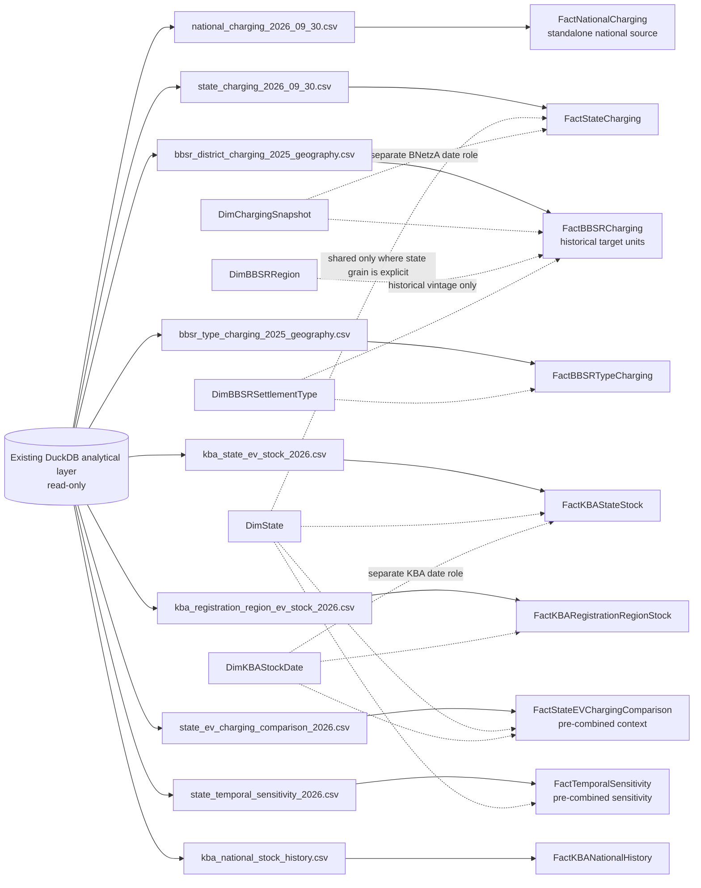

# Tableau Semantic Model — Batch 20

**Status:** design and validation specification only; no Tableau workbook, extract,
DuckDB table, view, schema, or ETL object is created by Batch 20.

**Evidence base:** the read-only DuckDB analytical layer, the nine validated
Batch 19 CSV contracts, and the 59-row Batch 18 KPI readiness register.

## 1. Recommended architecture

The recommended initial architecture is **Alternative A: separate Tableau data
sources backed by the existing validated exports**. Each data source represents
one analytical subject and has one declared fact grain. A workbook or worksheet
must select one subject fact at a time unless a relationship has an explicit
date, geography, and cardinality contract.

This is a semantic architecture, not a new physical star-schema deployment. The
existing exports already contain the validated aggregate grains needed for the
initial Tableau work. Creating physical Fact/Dimension tables solely to satisfy
a naming convention would add implementation effort and new duplication risks
without improving the approved analyses.

The dashed links are semantic contracts for future Tableau relationships or
data-source documentation. They do not authorize direct Fact-to-Fact joins.

## 2. Subject models

| Subject model | Logical facts | Initial Batch 19 source | Approved use |
|---|---|---|---|
| Charging Infrastructure | `FactNationalCharging`, `FactStateCharging` | National and state charging CSVs | BNetzA snapshot counts, power bands, shares, and nominal equipment power |
| BBSR Settlement-Type Analysis | `FactBBSRCharging`, `FactBBSRTypeCharging` | Historical BBSR district and type CSVs | Charging-only analysis on the BBSR 2025 historical target geography |
| KBA EV Stock | `FactKBAStateStock`, `FactKBARegistrationRegionStock`, `FactKBANationalHistory` | KBA state, registration-region, and national-history CSVs | Registered passenger-car stock, penetration, and same-grain stock changes |
| State EV/Charging Comparison | `FactStateEVChargingComparison` | Validated Batch 16 comparison CSV | One fixed July-KBA/September-BNetzA state comparison |
| Temporal Sensitivity | `FactTemporalSensitivity` | Validated Batch 17 temporal CSV | Published-versus-survivor sensitivity with an explicit non-historical label |

The national charging row is a presentation aggregate, not a seventeenth state.
It remains standalone and must not be unioned with state rows. The state
comparison and temporal sensitivity files are already pre-combined analytical
facts; they must not be rebuilt by relating the component facts in the same
worksheet.

## 3. Date roles

The model uses separate date roles. They are not interchangeable:

| Role | Current value/domain | Applies to | Rule |
|---|---|---|---|
| BNetzA infrastructure snapshot | `2026-09-30` | Charging facts | Describes the published register snapshot only |
| KBA vehicle-stock reference | `2026-01-01`, `2026-04-01`, `2026-07-01` | State and registration-region stock | Point-in-time registered stock; never sum stock over dates |
| BBSR geographic reference | `2025-12-31` | Historical BBSR facts | Geographic vintage applied to 2026 BNetzA charging; not an infrastructure date |
| Equipment commissioning date | Actual `core.charging_equipment.commissioning_date` | Future equipment-detail facts and Batch 17 sensitivity | Cohort field only; it does not create historical infrastructure stock |

The state comparison fact carries both `kba_reference_date = 2026-07-01` and
`bnetza_reference_date = 2026-09-30`. The temporal fact additionally carries
`survivor_cutoff_date = 2026-07-01` and its explicit survivor label.

## 4. Measure behavior

### Additive within a fixed snapshot and fact grain

- `equipment_count` and `equipment_rows` within a single BNetzA snapshot.
- `declared_charging_point_count` and `charging_point_count` within one
  charging geography and snapshot.
- `normal_charging_point_count`, `fast_charging_point_count`,
  `points_ge_150_kw`, `points_ge_350_kw`, and
  `unclassifiable_power_point_count` within one charging snapshot.
- `equipment_nominal_power_mw` when aggregated from equipment-grain rows only.
- KBA `passenger_car_stock`, `bev_passenger_car_stock`, and
  `phev_passenger_car_stock` across mutually exclusive regions within one KBA
  reference date and one reporting scope.

These measures are not additive across alternative reporting grains, national
and state aggregates, or multiple stock/snapshot dates.

### Semi-additive point-in-time measures

Vehicle stock, published charging stock, and declared nominal power describe a
point in time. They may be aggregated across compatible geography rows for one
date, but not across dates. Stock changes and growth are derived by comparing
two explicitly selected dates at the same geography grain.

### Non-additive measures

All percentage shares, penetration rates, ratios, gaps, ranks, percentiles,
correlations, status labels, and publication-status fields are non-additive.
Where a numerator and denominator are available, calculate
`SUM(numerator) / SUM(denominator)` at the selected fact grain. Never average
stored percentages or sum ratios.

`equipment_nominal_power_mw` is a measure of declared equipment-level nominal
power. It is not delivered energy, simultaneous capacity, utilization,
availability, or service quality.

## 5. Alternative-model evaluation

### Alternative A — domain-specific star schemas

Alternative A matches the evidence and approved questions. It keeps charging,
BBSR, KBA stock, state comparison, and temporal sensitivity at their validated
grains; limits each subject to the dimensions it can safely use; and makes
source-date warnings visible. It also avoids making a 211,253-point detail
extract a prerequisite for aggregate Tableau development.

### Alternative B — multi-fact relationship model

Tableau's multi-fact relationship capability could expose a shared `DimState`
to charging and KBA facts, but it does not remove the material differences in
geographic grain, date roles, or aggregation rules. A state charging fact has
one September row per state while a KBA state fact has three rows per state.
Relating them without a selected KBA date repeats the charging measures three
times. BBSR's 400 historical units and KBA's 400 registration regions look
similar in row count but have no approved relationship. National, state,
registration-region, and pre-combined comparison facts also carry unrelated
measures.

| Criterion | Alternative A | Alternative B |
|---|---|---|
| Analytical correctness | Strong: each subject keeps one declared grain | Conditional: depends on date-filtered relationships and careful measure isolation |
| Tableau development | Simple source selection and explicit contracts | More setup and more opportunities for repeated measures |
| Maintainability | Clear ownership by source/fact | Shared dimensions require ongoing cross-source key governance |
| Performance | Small, validated aggregate files | Potentially broader relationship queries and duplicated context |
| Reproducibility | Matches versioned Batch 19 files and manifest | Requires new marts/key pipelines not approved in Batch 20 |
| Future extensibility | Add a new subject source when evidence exists | Useful only after stable shared keys and date-role contracts are implemented |
| Implementation effort now | Low; no new tables required | High; physical marts and relationship testing would be needed |

**Decision:** use Alternative A now. Reconsider a multi-fact model only after a
future batch creates versioned dimensions, proves shared-key behavior, and has a
specific dashboard requirement that cannot be met by separate sources.

## 6. Geographic safeguards

- `DimState` represents the 16 German Bundesländer. `Deutschland` and
  `Sonstige` are KBA reconciliation scopes, not ordinary state members.
- `DimBBSRRegion` represents one harmonized BBSR 2025 historical target unit.
  The 401 source components are preserved in provenance; the target grain is
  400 units.
- Hanau and remaining Main-Kinzig-Kreis aggregate to historical BBSR
  `06435000`, type 2; this is not an official 2026 Hanau BBSR assignment.
- Kassel city retains corrected historical type 1 treatment.
- Trier city and Trier-Saarburg remain separate charging source components.
- KBA code `07211` remains one registration region per KBA date. No KBA stock
  is allocated between Trier city and Trier-Saarburg.
- BBSR and KBA geography dimensions must not be related merely because both
  contain 400-looking codes or similar labels. No KBA-to-BBSR vehicle-stock
  relationship is approved.

## 7. What a future implementation batch would add

The initial recommended architecture requires no new database tables: the nine
Batch 19 CSVs are sufficient for the approved aggregate subject models. A
future batch may create versioned DuckDB marts or controlled files if it needs
one of the following capabilities:

1. `dim_state` with an approved stable state key, rather than the current
   validated state-name business key.
2. `dim_bbsr_region_2025` and `dim_bbsr_settlement_type_2025` with explicit
   vintage/version fields.
3. `dim_kba_registration_region_2026` and `dim_kba_stock_date` for the three
   regional stock snapshots.
4. `dim_charging_snapshot` for BNetzA snapshot metadata.
5. `fact_bbsr_source_charging_2025` for the 401 source-grain BBSR charging
   distribution, if KPI `BBSR-014` is required in Tableau.
6. Equipment-status/commissioning, ownership, postcode, municipality,
   operator, payment, opening-hours, or connector-detail facts for the
   corresponding exploratory KPIs.
7. A separately approved, dated KBA-to-BBSR bridge before any vehicle-stock
   measure is related to BBSR geography.

None of these tables or files is created in Batch 20.

## 8. Related Batch 20 deliverables

- [Fact and dimension catalog](tableau-fact-dimension-catalog.md)
- [Relationship design and validation contracts](tableau-relationship-design.md)
- [Semantic-model validation report](../reports/batch20_semantic_model_validation.md)
- [Architecture decision](../reports/batch20_architecture_decision.md)
- [59-KPI model mapping](../reports/batch20_kpi_model_mapping.csv)

## 9. Batch 21 implementation binding

Batch 21 applies the separate-source recommendation to exactly two executive
dashboards without changing the logical fact contracts. The initial workbook
source list is:

- one-row national BNetzA charging;
- four-row mutually exclusive power bands;
- 33-row national KBA history;
- two-row equipment status;
- 16-row state BNetzA charging; and
- the existing 16-row pre-combined state EV/charging comparison.

Each worksheet is assigned to one of these sources. No relationship is created
between them, and no national row is unioned with state rows. The state table
and BEV penetration chart use the pre-combined fixed-date comparison rather
than rebuilding a relationship between three KBA dates and one BNetzA row.

The presentation specification defines Tableau calculated fields as ratios of
aggregated numerators and denominators. It retains the canonical KPI statuses;
`bevs_per_charging_point` is excluded from the executive table, and no
`NOT_SUPPORTED` KPI is promoted. See
[`docs/tableau-executive-overview.md`](tableau-executive-overview.md) for
worksheet-level instructions and
[`reports/batch21_tableau_overview_validation.md`](../reports/batch21_tableau_overview_validation.md)
for measured checks.
