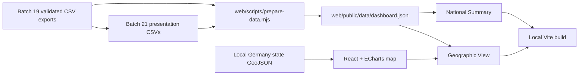

# Web dashboard architecture

## Status and boundary

Batch 23 adds a local, static web dashboard for the validated Batch 19 Tableau
export contracts and Batch 21 presentation preparation. It is a presentation
layer, not a replacement for the DuckDB model and not a new analytical source.
The browser does not connect to DuckDB, the official workbooks, or an external
API.

The build is deterministic:

1. `web/scripts/prepare-data.mjs` reads the six approved CSV inputs.
2. It verifies Batch 19 manifest hashes, row counts, column counts, dates,
   state membership, national/state reconciliations, the 33-row history, and
   the four mutually exclusive power bands.
3. It writes one normalized artifact at
   `web/public/data/dashboard.json`, including source checksums, source dates,
   validation results, and map provenance.
4. Vite serves the React application and the browser reads only that JSON and
   the local GeoJSON asset.



## Runtime structure

- `web/src/App.tsx` provides the hash-based two-page shell, header navigation,
  loading/error states, source-date footer and page routing.
- `web/src/pages/NationalSummary.tsx` renders the national cards, interactive
  power-band mix, KBA stock history, and equipment status view.
- `web/src/pages/GeographicView.tsx` renders the local 16-state map, ranking,
  comparison table, BEV-penetration chart and cross-panel selection state.
- `web/src/components/EChart.tsx` owns ECharts registration, resize handling,
  disposal and option updates; chart components receive no raw CSV input.
- `web/src/theme.ts` and `web/src/styles.css` define the dark navy canvas,
  white cards, cyan/blue infrastructure palette, amber fast-power accent and
  restrained typography/spacing tokens.

The pages intentionally use separate semantic components for KPI cards, chart
cards, date/source labels and selection banners. This keeps source dates and
methodology notes attached to the views that need them rather than hiding them
in a global legend.

## Data and relationship rules

The dashboard preserves the existing contracts:

- equipment rows and charging-point slots remain different grains;
- charging power is classified by the maximum declared power per point;
- the four displayed power bands are mutually exclusive and sum to 211,253;
- KBA stock is registered passenger-car stock, not sales;
- the national KBA total and the 16-state KBA total remain visibly distinct;
- the state comparison is explicitly cross-snapshot: KBA 2026-07-01 versus
  BNetzA 2026-09-30;
- no BEVs-per-point, adequacy, utilization, demand, shortage, or causal KPI is
  introduced.

No database, raw workbook, reference crosswalk, or Batch 19 export is written
by the web preparation script.

## Geographic asset

The map uses the local low-resolution federal-state GeoJSON asset at
`web/public/data/germany-states.geo.json`. It contains 16 named features with
the `DE-XX` state codes used by the dashboard. The source, license, access
date, checksum, and GIS-DATA/DIVA-GIS attribution are recorded in
`web/public/data/geo-attribution.md` and are shown in the page footer.

The geometry is used only for visual state recognition. All displayed metrics
come from validated CSV exports and are joined by the explicit state name/code
contract in the prepared JSON; values are never inferred from geometry.

## Local operation

From `web/`:

```bash
npm install
npm run check
npm run build
npm run preview
npm run dev -- --host 127.0.0.1
```

The local routes are `/#national` and `/#geographic`. `npm run check` rebuilds
the JSON artifact and runs TypeScript validation. `npm run build` performs the
production Vite build, and `npm run preview` serves that built bundle locally.
